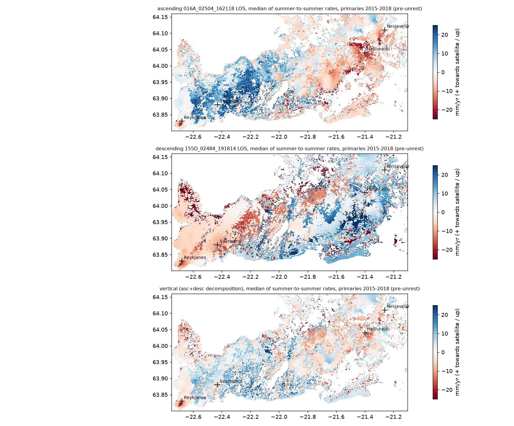
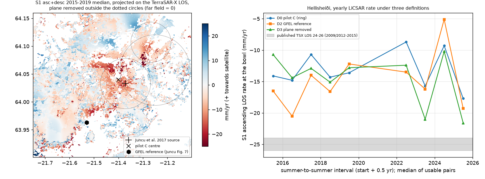
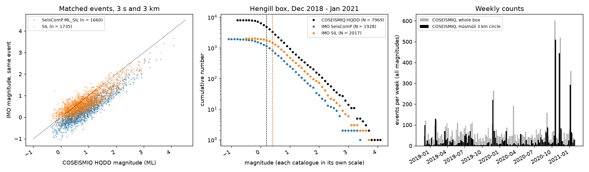
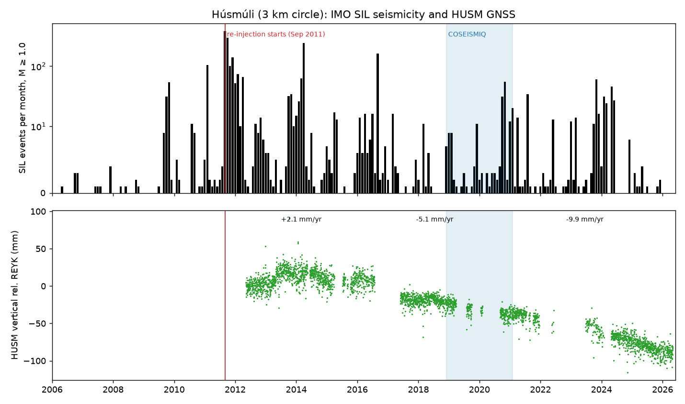

# iceland-volcano-watch

An open, reproducible monitor of Reykjanes Peninsula volcanism and geothermal deformation, built from free data:
Nevada Geodetic Laboratory (NGL) GNSS, the Icelandic Met Office (IMO) Quakes API and COMET LiCSAR Sentinel-1
interferograms. It measures:
- the Svartsengi magma domain (inflation, Mogi source, volume per cycle);
- the seismicity of the Sundhnúkur dikes;
- subsidence of the Hengill and Svartsengi geothermal fields.

> **Status (2026-11-16): four pilots, run end to end, plus an external review folded in.** This repository does
> measurement and retrospective statistics only. It makes **no eruption forecasts**; for hazard information see the
> [Icelandic Met Office](https://en.vedur.is/).
>
> - Method and limitations: [docs/method.md](docs/method.md).
> - Prior work: [docs/prior-work.md](docs/prior-work.md).
> - Corrections to earlier versions: [docs/corrections.md](docs/corrections.md).
> - Reports: [pilot](reports/2026-11-12-pilot.md), [Hengill catalogue](reports/2026-11-14-hengill-catalog.md),
>   [Hellisheiði and review](reports/2026-11-16-hellisheidi-and-review.md).


## Results (measured here vs. published)

Sign conventions:
- LOS rates: positive = towards the satellite, so subsidence is negative.
- Vertical: positive = up.
- Volumes: Mm³ = 10⁶ m³.
- Rates: per year unless stated.

### A. Svartsengi magma domain, NGL GNSS + Mogi point source

All volumes are **Mogi cavity volume changes** (ΔV of the chamber). If the magma is compressible, the volume of magma
that flowed in is larger, so inflow rates here are lower bounds (Rivalta & Segall 2008). Parks et al. 2025 use the
same convention, so the comparisons below are like with like.

| Quantity | This work | Published | Verdict |
|---|---|---|---|
| Mogi source, 4 inflation intervals Oct 2024-Oct 2026 | −22.444 to −22.472 E, 63.866-63.874 N, best depths 3.50-4.75 km. **χ²/dof = 9.3, 24.5, 19.0, 30.3**: the point source does not fit to within the errors | −22.454 E, 63.869 N, 4 km (Parks et al. 2025); 3-6 km (EGU25) | 0.45-0.95 km from Parks' source horizontally; depth intervals are not formal (see below) |
| Inflow, first cycle (15 Nov-17 Dec 2023) | 7.0 m³/s (8.4 with Parks' source) | ~7-9 m³/s | consistent |
| Inflow, cycles Jun 2024-Mar 2025 | 2.0-3.1 m³/s (2.4-3.7 with Parks' source) | 2.4-4 m³/s | consistent, ours at the low end |
| Volume lost per event (SENG only) | see `event_volume_loss.csv` | Parks et al. 2025 Table 1 | **not validated**: a selection rule fixed in advance (dike seismicity ≥ 3 km from SENG) passes no event; at 2 km, events 3, 4, 8, 9, 10 have ratios −0.26 to 1.22 |
| Recharge before events 7-11 | 17.0, 21.2, 18.2, 21.8, 20.8 Mm³ | 17-23 Mm³ ("last five events", EGU26-6017) | consistent, all five inside the range |
| Accumulated since the 16 Jul 2025 eruption, at 21 Jul / 16 Aug 2026 | 29.1 / 30.2 Mm³ (median source, 3.875 km). Range over source depth 3.50-4.75 km and Parks' source: **24.6-41.6 / 25.5-43.2 Mm³** | IMO 28.3 (27.5-29.1) / 29.1 (28.3-29.9) Mm³, 95 % | consistent within the source-geometry uncertainty; our central value is at or just above IMO's upper bound |
| SENG uplift, 3 months to 15 Sep / 30 Sep 2026 | 49.2 / 41.1 mm | IMO "about 5 cm" / "about 4 cm" | consistent |
| Current cycle to 17 Oct 2026 (452 days from the post-event level) | **32.5 Mm³**; inflow per 3 months 1.23 → 0.97 → 0.56 → 0.51 → 0.47 m³/s | IMO: slowest accumulation so far | largest recharge of any cycle, lowest inflow |

**Uncertainty of the volumes.** SENG's sensitivity to the source is 18.1 / 14.4 / 9.5 mm per Mm³ at 3.25 / 3.75 /
4.75 km depth. The same 450 mm of uplift is therefore 24.8, 31.4 or 47.3 Mm³ (`volume_sensitivity_source.csv`).
- In the fits, depth and ΔV are correlated (0.87-0.95). With errors rescaled by sqrt(χ²/dof), 1σ is 0.7-1.0 km in
  depth and 35-42 % in ΔV (`mogi_correlation.json`).
- 4-5 stations constrain 6 parameters. With the horizontal position held at Parks', depths are 4.0-4.25 km with
  similar misfit.
- Ratios between cycles (below) do not depend on the source, because one fixed source is used for all of them.

**Volume-threshold check (retrospective).**
- From March 2024 to July 2025, each new dike came after 17.0-21.8 Mm³ of recharge.
- The current cycle entered that range on ~6 Dec 2025 and passed its top on ~16 Feb 2026.
- It stands at 32.5 Mm³ (+49.5 % above the largest earlier recharge), with no dike as of 17 Oct 2026.
- The pattern that held through 2025 has not held in 2025-2026. This is a measurement of the past, not a statement
  about when or whether the next event happens.


### B. Seismicity, IMO Quakes API (reviewed events)

| Quantity | This work | Published / note |
|---|---|---|
| 10-11 Nov 2023 dike (SIL, 793 events) | strike **N37°E**, length **15.4 km** (2.5-97.5 %), depth p10/p50/p90 = 3.2/5.0/6.4 km, extent 3.6 → 15.5 km between 15:00 and 18:00 UTC (~6 km/h) | ~15 km dike (Sigmundsson et al. 2024); onset 16:55 UTC (Parks et al. 2025) |
| b, dike swarm | b-positive **1.00 ± 0.05**; Aki-Utsu 0.54 ± 0.02 above Mc 2.2 (biased by swarm incompleteness) | |
| b, inter-event Dec 2023-Jul 2025 (SeisComP) | b-positive **1.18 ± 0.02** (Aki 0.78 above Mc −0.3) | Figlioli et al. 2026: b changes not uniquely tied to eruptions |
| b, current cycle (SeisComP) | b-positive **0.93 ± 0.06** (Aki 0.86 ± 0.04, Mc −0.5, N = 286) | |
| b, Svartsengi 2020-Oct 2023 (SIL) | b-positive 0.99 ± 0.01 (Aki 0.70, Mc 0.8) | |
| Rate M ≥ −0.3 between events (SeisComP) | 1.5-30 events/day in Dec 2023-Jul 2025; **0.42/day** in the current cycle (3.4× lower than the quietest earlier cycle, 1.46/day) | |
| Rate vs inflow over 10 cycles | Spearman ρ = 0.83 (p = 0.003) | time trend confounds it (both fall with time) |
| SIL vs SeisComP magnitudes | 49,531 matched events: SeisComP `ML_SIL` is **0.62 lower** (IQR 0.45-0.82) | do not mix the two scales |


### C. Geothermal-field deformation, LiCSAR summer-to-summer pairs + GNSS

| Field | This work, 2015-2019 primaries | Published | Verdict |
|---|---|---|---|
| Hellisheiði (Hengill) | LOS asc −14.6 mm/yr (pilot statistic); −13.1 with the statistic below; vertical −15.0 | "up to 26" (2012-15) and "~24" (from 2009) mm/yr LOS, TerraSAR-X, plate-corrected single extreme values (Juncu et al. 2017; EGU2015). **Same statistic** (p5 within 1.5 km, minus a 4-7 km ring) on the published maps: −17.6 (TSX 2012-15, plate-corrected), −16.2 (TSX 2012-15, observed), −15.4 (TSX 2015-17), −15.3 (Sentinel-1 track 16, 2015-17; Ducrocq et al. 2021) | **explained difference**: the 24-26 is a different quantity. With matched definitions the gap to the published Sentinel-1 map is ~2 mm/yr. No rate drop after 2015 |
| Nesjavellir (Hengill) | asc −18.7, desc −11.3, vertical −13.5 mm/yr | GNSS NE63 −18 mm/yr (2012-15) | similar |
| Reykjanes | asc −17.0, desc −15.3 mm/yr LOS | ~16 mm/yr LOS (S1 2015-2017) | consistent |
| Svartsengi | vertical −13.3 mm/yr (peak); SENG GNSS −16.4 mm/yr absolute, −10.9 relative to NYLA | 7-14 mm/yr (1975-2015), ~1 cm/yr near the plant | consistent |
| HUSM (Húsmúli), GNSS rel. REYK | +2.1 mm/yr (2012-15), −5.1 (2017-19), −9.9 (2020-26) | ~2 cm uplift in the first months of injection, 2011-12 (Juncu et al. 2020); localised subsidence 2017-18 (Ducrocq et al. 2021) | 2017-19 agrees in sign; 2012-15 is after the published uplift episode; 2020-26 not in the literature we found |

How the Hellisheiði numbers were matched (details in the 2026-11-16 report):
- The plate-motion correction is worth about −5 mm/yr at the bowl in Juncu's own figure.
- "Up to" vs a 5th percentile is worth about −2.
- Viewing geometry is below 1 (our asc+desc re-projected onto the TerraSAR-X LOS: −15.8 vs −15.5).
- Phase bias from short pairs is below 1 mm per summer (closure +0.22 mm over 72 days, +0.55 mm over 114 days).
- The annual pairs agree with GNSS (HUSM−REYK) to +0.16 ± 2.2 mm/yr (ascending, 8 pairs).
- Production fell from ~40 to ~32 Mt/yr in 2015 (Juncu et al. 2017), but the same-sensor maps give −16.2 (2012-15)
  and −15.4 (2015-17), and our 2015-2026 series has no trend.

**Svartsengi: geothermal vs magmatic.** With this data, the two signals **cannot be separated in space**. The
geothermal bowl and the Mogi source lie within ~1.5 km of each other.
- What can be done is a bound. The pre-unrest geothermal trend at SENG (−16.4 mm/yr) is 0.5 % of the magmatic
  uplift rate in the first cycle (~3,000 mm/yr, Nov-Dec 2023), but ~8 % of it in Jul-Oct 2026 (~200 mm/yr).
- We remove it as a constant term.
- Tested (`volume_sensitivity_background.csv`):
  - other pre-unrest windows give −15.8 to −16.8 mm/yr and change the cycle volume by ≤ 0.05 Mm³;
  - removing the geothermal term entirely (NYLA rate only) changes it by −0.85 Mm³ and the last 3-month inflow from
    0.47 to 0.45 m³/s.
- Whether production changed after 2023 is unknown.




### D. Hengill: the Zenodo "Hengill seismic catalog" against IMO, and Húsmúli re-injection

**What the catalogue is.** Zenodo 10.5281/zenodo.16311162 (University of Campania, 2025, CC BY 4.0) gives no method
and no magnitude type. All 8,691 rows are the events of the COSEISMIQ high-quality double-difference catalogue
(Grigoli et al. 2022; figshare, CC0), whose magnitudes are local ML from a dense temporary network, Dec 2018 to
Jan 2021. The Zenodo copy has four defects:
- the record swaps the magnitude and depth columns;
- the 2,054 negative magnitudes have lost their minus sign;
- "time (sec)" is really (days since 2018-01-01 + 1)/365, with 3-32 s resolution;
- 1,517 rows are one day off.

We therefore use the original HQDD file for the numbers below.

**What the defects do to Mc and b** (all 8,691 rows, `hengill_catalog.json` → `damaged_copy_effect`):

| Input | Mc | b (Aki-Utsu, 95 %) | b-positive | N ≥ Mc |
|---|---|---|---|---|
| COSEISMIQ HQDD (reference) | 0.2 | 0.88 (0.86-0.90) | 1.02 ± 0.02 | 5,330 |
| Zenodo column 5 (= abs(ML), signs lost) | 0.4 | 0.95 (0.91-0.98) | 1.13 ± 0.02 | 3,832 |
| Zenodo column 4, as the record text says (= depth in km) | 2.1 | 0.27 | 0.31 | 5,157 |

Folding the negative magnitudes onto the positive side raises Mc by 0.2, b by 0.07 and b-positive by 0.11. Following
the record text gives a "b-value" of depths.

**(a) Against IMO, Hengill box, 2018-12-01 to 2021-01-31 (793 days).**

| | COSEISMIQ HQDD (ML) | IMO SeisComP (`ML_SIL`) | IMO SIL |
|---|---|---|---|
| Events | 7,969 | 1,928 | 2,017 |
| Mc (max of MAXC+0.2, GFT) | 0.2 | 0.4 | 0.8 |
| b (Aki-Utsu, 95 % bootstrap) | 0.88 (0.86-0.90) | 0.87 (0.82-0.94) | 0.91 (0.85-0.98) |
| b-positive | 1.01 ± 0.02 | 0.79 ± 0.03 | 0.95 ± 0.03 |
| Rate above own Mc | 6.2 per day | 1.0 per day | 0.94 per day |
| IMO magnitude − COSEISMIQ, matched events (median, IQR) | | −0.51 (−0.70 to −0.35), n = 1,660 | −0.15 (−0.38 to +0.06), n = 1,735 |

- COSEISMIQ has about 4 times as many events. Its Mc of 0.2 corresponds to about −0.3 in SeisComP units and 0.05 in
  SIL units (median offsets), so it is complete about 0.7 magnitude units lower than either IMO system.
- 88 % of IMO events above IMO's own Mc are in COSEISMIQ (both systems).
- The three Aki-Utsu b-values agree within their intervals; b-positive differs more between catalogues (0.79-1.01).
- The SeisComP-SIL gap here, about 0.36 by way of COSEISMIQ, is smaller than the 0.62 measured directly on
  Reykjanes events (B). The two numbers come from different regions and periods and were not reconciled.

**(b) Húsmúli re-injection, 3 km circle.** 47 % of COSEISMIQ's events in the box lie in this circle, at a median
depth of 2.0 km (3.5 km for the rest of the box). The long series uses IMO SIL at M ≥ 1.0:

| Period | SIL events per year, M ≥ 1.0 | Largest M | HUSM vertical rel. REYK |
|---|---|---|---|
| 2006-2010, before injection | 29 | 2.88 | (no data) |
| Jan-Aug 2011 (105 of these events in February 2011) | 183 | 2.56 | (no data) |
| Sep-Dec 2011, injection starts | 2,751 | 4.04 | (no data) |
| Jun 2012-2015 | 158 | 2.71 | +2.1 mm/yr |
| Mar 2017-2019 | 35 | 2.34 | −5.1 mm/yr |
| 2020-2025 | 83 | 3.65 | −9.9 mm/yr |

The seismicity rate does not follow the GNSS in one direction. Injection volumes are not open, so the cause stays
untested.




## Reproduce

```bash
uv venv --python 3.12 .venv && uv pip install --python .venv/bin/python -r requirements.txt
.venv/bin/python -I -m unittest discover -s tests -v      # 22 synthetic tests, no data needed
```

The full pipeline (downloads about 190 MB into the git-ignored `data/`) is in [docs/method.md](docs/method.md).
Fixed inputs with sources are in `config/svartsengi.json`. Every number above comes from a file in `docs/data/`
written by a script in `scripts/`.

## Data and licences

| Data | Licence / terms | Attribution used here |
|---|---|---|
| IMO Quakes API (`api.vedur.is/quakes`, spec 2026-08-06) | CC BY 4.0 (stated in the OpenAPI `info.license`); IMO terms at en.vedur.is/about-imo/the-web/conditions | "Earthquake data: Icelandic Meteorological Office (Veðurstofa Íslands), Quakes API, CC BY 4.0" |
| IMO volume and uplift numbers | quoted from IMO news items (dated in `config/svartsengi.json`) | cited as text, not redistributed as data |
| COMET LiCSAR products | UK Open Government Licence v3 (CEDA record "LiCSAR interferometry products", Lazecký & Maghsoudi 2022) | "LiCSAR contains modified Copernicus Sentinel data 2015-2026 analysed by the Centre for the Observation and Modelling of Earthquakes, Volcanoes and Tectonics (COMET). LiCSAR uses JASMIN, the UK's collaborative data analysis environment (http://jasmin.ac.uk)" |
| NGL GNSS time series (IGS20 `.tenv3`) | no explicit licence found on geodesy.unr.edu; NGL asks users to cite Blewitt et al. 2018 and the stations' original data citations | Blewitt, Hammond & Kreemer 2018. Original station data: IMO and other Icelandic operators; per-station DOIs not yet collected (see method) |
| COSEISMIQ catalogues (figshare 10.6084/m9.figshare.19217130 and collection c.5725592) | CC0 | Grigoli et al. 2022 |
| Zenodo 10.5281/zenodo.16311162 | CC BY 4.0 | University of Campania 2025 |
| Published figures (Juncu et al. 2017 Fig. 7; Ducrocq et al. 2021 Fig. 5) | read by colour into a few summary numbers; the figures and PDFs are not redistributed | cited |

The repository holds only derived tables and figures. Raw downloads stay in `data/` (git-ignored). The code has no
licence file yet.

## Next steps

1. Use the InSAR in the Mogi fit (LiCSAR 6-12 day pairs during inflation) to tie down depth. Depth is the main
   volume uncertainty (±35-40 %).
2. Model the dikes (Okada) or estimate losses from stations away from them; the single-station loss is not validated.
3. Find out why the Aug 2025-Oct 2026 interval fits poorly with one Mogi source (χ²/dof 30).
4. Hellisheiði: the remaining ~2 mm/yr against the published Sentinel-1 map; EGMS for 2019-2023.
5. Automatic daily update (NGL rapid series + Quakes API) that appends to the volume and rate series.

## Sources

- Parks, M. et al. 2025. 2023-2024 inflation-deflation cycles at Svartsengi and repeated dike injections and
  eruptions at the Sundhnúkur crater row, Reykjanes Peninsula, Iceland. *EPSL* 658: 119324.
  doi:10.1016/j.epsl.2025.119324.
- Parks, M. et al. 2026. 2025 diking events and eruptions within the Svartsengi volcanic system. EGU26-6017.
- Sigmundsson, F. et al. 2024. Fracturing and tectonic stress drive ultrarapid magma flow into dikes. *Science* 383:
  1228-1235. doi:10.1126/science.adn2838.
- Juncu, D. et al. 2017. Anthropogenic and natural ground deformation in the Hengill geothermal area, Iceland.
  *JGR Solid Earth* 122: 692-709. doi:10.1002/2016JB013626.
- Juncu, D. et al. 2020. Injection-induced surface deformation and seismicity at the Hellisheidi geothermal field,
  Iceland. *JVGR* 391: 106337. doi:10.1016/j.jvolgeores.2018.03.019.
- Juncu, D. et al. 2015. EGU2015-13455 (abstract).
- Ducrocq, C. et al. 2021. Inflation-deflation episodes in the Hengill and Hrómundartindur volcanic complexes, SW
  Iceland. *Front. Earth Sci.* 9: 725109. doi:10.3389/feart.2021.725109.
- Grigoli, F. et al. 2022. Monitoring microseismicity of the Hengill Geothermal Field in Iceland. *Scientific Data*
  9: 220. doi:10.1038/s41597-022-01339-w.
- Flóvenz, Ó. G. et al. 2022. Cyclical geothermal unrest as a precursor to Iceland's 2021 Fagradalsfjall eruption.
  *Nature Geoscience* 15: 397-404. doi:10.1038/s41561-022-00930-5.
- Rivalta, E. & Segall, P. 2008. Magma compressibility and the missing source for some dike intrusions. *GRL* 35(4).
  doi:10.1029/2007GL032521.
- Segall, P. 2010. *Earthquake and Volcano Deformation*. Princeton University Press. doi:10.1515/9781400833856.
- Figlioli et al. 2026, *Bollettino di Geofisica Teorica ed Applicata* (Reykjanes b-value, 2020-2024); not checked
  in Crossref.
- Blewitt, G., Hammond, W. C. & Kreemer, C. 2018. Harnessing the GPS data explosion for interdisciplinary science.
  *Eos* 99. doi:10.1029/2018EO104623.
- Lazecký, M. et al. 2020. LiCSAR: an automatic InSAR tool for measuring and monitoring tectonic and volcanic
  activity. *Remote Sensing* 12: 2430. doi:10.3390/rs12152430.
- Icelandic Met Office news, 2025-2026 (en.vedur.is); IMO Quakes API.
