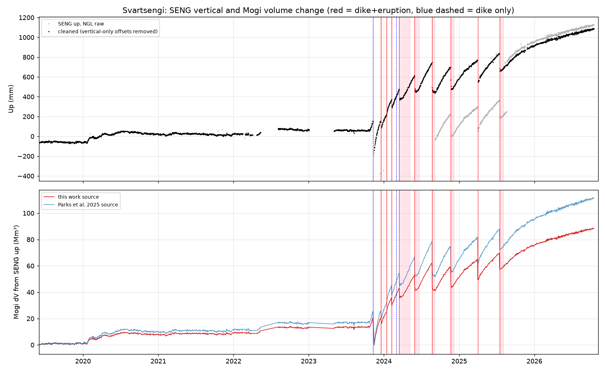
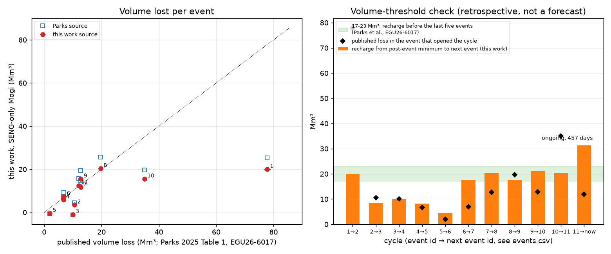
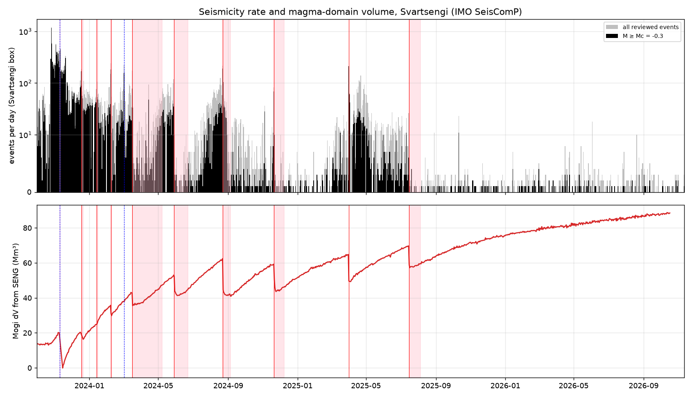
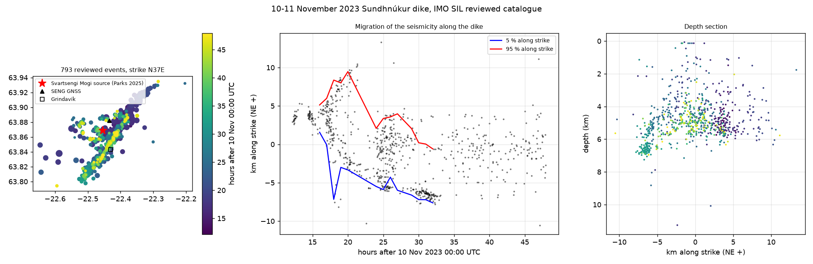

# iceland-volcano-watch

An open, reproducible monitor of Reykjanes Peninsula volcanism and geothermal deformation, built from free data:
Nevada Geodetic Laboratory (NGL) GNSS, the Icelandic Met Office (IMO) Quakes API (CC BY 4.0) and COMET LiCSAR
Sentinel-1 interferograms. It measures the Svartsengi magma domain (inflation, Mogi source, volume per cycle), the
seismicity of the Sundhnúkur dikes, and subsidence of the Hengill and Svartsengi geothermal fields.

> **Status (2026-11-12): three pilots, all run end to end.** This repository does measurement and retrospective
> statistics only. It makes **no eruption forecasts**; for hazard information see the
> [Icelandic Met Office](https://en.vedur.is/).
> Method and limitations: [docs/method.md](docs/method.md). Prior work and the gap:
> [docs/prior-work.md](docs/prior-work.md). Pilot report: [reports/2026-11-12-pilot.md](reports/2026-11-12-pilot.md).

## Results (measured here vs. published)

### A. Svartsengi magma domain, NGL GNSS + Mogi point source

| Quantity | This work | Published | Verdict |
|---|---|---|---|
| Mogi source, 4 inflation intervals Oct 2024-Oct 2026 | −22.440 to −22.472 E, 63.866-63.874 N, **3.25-4.75 km** deep (jackknife 2.5-5.0 km) | −22.454 E, 63.869 N, 4 km (Parks et al. 2025); 4-5 km; 3-6 km (EGU25) | agrees, ≤ 1 km horizontal offset |
| Inflow, first cycle (15 Nov-17 Dec 2023) | 7.2 m³/s (9.1 with Parks' source) | ~7-9 m³/s | agrees |
| Inflow, cycles May 2024-Mar 2025 | 1.9-3.2 m³/s (2.4-4.0 with Parks' source) | 2.4-4 m³/s | agrees |
| Volume lost at events 4, 6, 7, 8, 9, 11 | 5.9, 7.4, 11.7, 20.3, 15.5, 12.4 Mm³ | 6.7, 6.9, 12.7, 19.7, 12.8, ~12 Mm³ | agrees, ratio 0.87-1.21 |
| Volume lost at events 1, 2, 3, 5, 10 | 20, 3.5, −0.9, −0.4, 15.5 Mm³ | 77.8, 10.6, 10.0, 2.0, ~35 Mm³ | **fails**: the dike deforms SENG (single-station method) |
| Recharge before events 7-11 | 17.5, 20.5, 17.6, 21.2, 20.4 Mm³ | 17-23 Mm³ ("last five events", EGU26-6017) | agrees, all five inside the range |
| Accumulated since 17 Jul 2025, at 21 Jul / 18 Aug 2026 | 28.0 / 29.2 Mm³ (35.3 / 36.9 with Parks' source) | IMO 28.3 (27.5-29.1) / 29.1 (28.3-29.9) Mm³ | agrees with our source; +25 % with Parks' |
| SENG uplift, 3 months to 15 Sep / 30 Sep 2026 | 54.6 / 46.7 mm | IMO "about 5 cm" / "about 4 cm" | agrees |
| Current cycle to 17 Oct 2026 (457 days) | **31.2 Mm³** recharged; inflow 1.41 → 0.79 → 0.60 → 0.53 → 0.44 m³/s per quarter | IMO: slowest accumulation so far | largest recharge of any cycle, lowest inflow |

**Volume-threshold check (retrospective).** From March 2024 to July 2025, each new dike came after 17.5-21.2 Mm³
of recharge. The current cycle entered that range on ~15 Dec 2025, passed its top on ~24 Feb 2026, and stands at 31.2 Mm³ (+47 % above the
largest earlier recharge) with no dike as of 17 Oct 2026. The pattern that held through 2025 has not held in
2025-2026. This is a measurement of the past, not a statement about when or whether the next event happens.

### B. Seismicity, IMO Quakes API (reviewed events)

| Quantity | This work | Published / note |
|---|---|---|
| 10-11 Nov 2023 dike (SIL, 793 events) | strike **N37°E**, length **15.3 km** (2.5-97.5 %), depth p10/p50/p90 = 3.2/5.0/6.4 km, extent 3.5 → 15.5 km between 15:00 and 18:00 UTC (~6 km/h) | ~15 km dike (Sigmundsson et al. 2024); onset 16:55 UTC (Parks et al. 2025) |
| b, dike swarm | b-positive **1.00 ± 0.05**; Aki-Utsu 0.54 ± 0.02 above Mc 2.2 (biased by swarm incompleteness) | |
| b, inter-event Dec 2023-Jul 2025 (SeisComP) | b-positive **1.18 ± 0.02** (Aki 0.78 above Mc −0.3) | Figlioli et al. 2026: b changes not uniquely tied to eruptions |
| b, current cycle (SeisComP) | b-positive **0.93 ± 0.06** (Aki 0.86 ± 0.04, Mc −0.5, N = 286) | |
| b, Svartsengi 2020-Oct 2023 (SIL) | b-positive 0.99 ± 0.01 (Aki 0.70, Mc 0.8) | |
| Rate M ≥ −0.3 between events (SeisComP) | 1.5-30 events/day in Dec 2023-Jul 2025; **0.42/day** in the current cycle (3.4× lower than the quietest earlier cycle, 1.46/day) | |
| Rate vs inflow over 10 cycles | Spearman ρ = 0.83 (p = 0.003) | time trend confounds it (both fall with time) |
| SIL vs SeisComP magnitudes | 49,531 matched events: SeisComP `ML_SIL` is **0.62 lower** (IQR 0.45-0.82) | do not mix the two scales |

### C. Geothermal-field deformation, LiCSAR summer-to-summer pairs + GNSS

| Field | This work, pre-unrest 2015-2019 | Published | Verdict |
|---|---|---|---|
| Hellisheiði (Hengill) | peak LOS asc −14.6 mm/yr (yearly −10.8 to −24.4), desc −12.3, vertical −15.0 mm/yr | ~24-26 mm/yr LOS, TerraSAR-X 2009/2012-2015 (Juncu et al.); GNSS max −23 mm/yr | **lower**: ~60 % of the published peak. 2015-16 alone gives −24.4. Either the rate has dropped or ~100 m LiCSAR pixels smooth the peak; not separated |
| Nesjavellir (Hengill) | asc −18.6, desc −11.3, vertical −13.6 mm/yr | GNSS NE63 −18 mm/yr (2012-15) | similar |
| Reykjanes | asc −17.0, desc −15.3 mm/yr LOS | ~16 mm/yr LOS (S1 2015-2017) | agrees |
| Svartsengi | vertical −13.3 mm/yr (peak); SENG GNSS −16.4 mm/yr absolute, −10.9 relative to NYLA | 7-14 mm/yr (1975-2015), ~1 cm/yr near the plant | agrees |
| HUSM (Húsmúli), GNSS rel. REYK | +2.1 mm/yr (2012-15), −5.1 (2017-19), −9.9 (2020-26) | up to ~2 cm re-injection uplift since 2011 (Juncu et al. 2018) | uplift matches 2012-15; later subsidence not in the literature we found |

**Svartsengi: geothermal vs magmatic.** With this data, the two signals **cannot be separated in space**. The
geothermal bowl and the Mogi source lie within ~1.5 km of each other. What can be done is a bound: the
pre-unrest geothermal trend at SENG (−16.4 mm/yr) is 0.5 % of the magmatic uplift rate in the first cycle
(~3,300 mm/yr, Nov-Dec 2023) but already ~8 % of it in Jul-Oct 2026 (~200 mm/yr). As inflow slows, the
geothermal term matters more. We remove it as a constant term. Whether production changed after 2023 (lava barriers, plant
shutdowns) is unknown, so the bound assumes steady production.

## Data used

- NGL IGS20 daily `.tenv3`: SENG, AUSV, GEVK, VOGC, NYLA, HUSM, REYK (+ VOGS, SEL3, HVER, OLKE looked at). 16 MB with the station list and steps file.
- IMO Quakes API (21 MB): SIL reviewed 2020-01-01 to 2026-06-01 (143,538 earthquakes); SeisComP 2023-10-01 to
  2026-11-11 (58,881 reviewed earthquakes). Box 63.70-64.20 N, 22.9-21.0 W.
- LiCSAR: 27 ascending + 9 descending summer annual pairs, cropped to 63.80-64.16 N, 22.75-21.10 W (71 MB).
- Papers for comparison: Parks et al. 2025 (EPSL), Juncu et al. 2017 (JGR), both from open repositories.

## Next steps

1. Use the InSAR in the Mogi fit (LiCSAR 6-12 day pairs during inflation) to tie down depth and fix the
   single-station volume losses for dikes near SENG.
2. Add a dike (Okada) source for events 1, 2, 3, 5 and 10, or estimate losses from stations away from the dike.
3. Find out why the Aug 2025-Oct 2026 interval fits poorly with one Mogi source (sill shape vs. graben motion).
4. Hengill: add the 2019-2022 ascending pairs once LiCSAR serves them again, and compare with EGMS.
5. Automatic daily update (NGL rapid series + Quakes API) that appends to the volume and rate series.

## Sources

- Parks, M. et al. 2025. 2023-2024 inflation-deflation cycles at Svartsengi and repeated dike injections.
  *Earth and Planetary Science Letters* 658: 119324.
- Parks, M. et al. 2026. 2025 diking events and eruptions within the Svartsengi volcanic system. EGU26-6017.
- Sigmundsson, F. et al. 2024. Fracturing and tectonic stress drive ultrarapid magma flow into dikes. *Science*.
- Juncu, D. et al. 2017. Anthropogenic and natural ground deformation in the Hengill geothermal area, Iceland.
  *JGR Solid Earth* 122: 692-709. Juncu, D. et al. 2018, *JVGR*.
- Figlioli et al. 2026, *Bollettino di Geofisica Teorica ed Applicata* (Reykjanes b-value, 2020-2024).
- Icelandic Met Office news, 2025-2026 (en.vedur.is); IMO Quakes API (CC BY 4.0).
- Blewitt, G., Hammond, W. C. & Kreemer, C. 2018. Harnessing the GPS data explosion for interdisciplinary science.
  *Eos* 99 (NGL time series).
- Lazecký, M. et al. 2020. LiCSAR: an automatic InSAR tool for measuring and monitoring tectonic and volcanic
  activity. *Remote Sensing* 12: 2430. Contains modified Copernicus Sentinel data (2015-2026).
