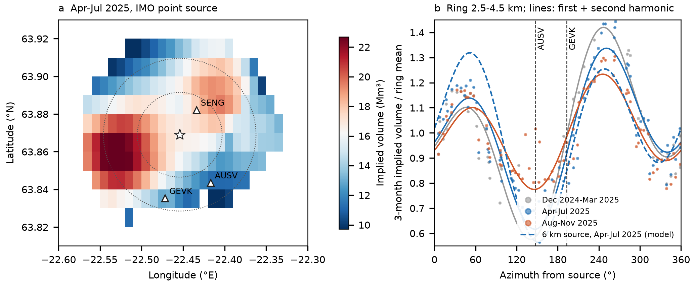
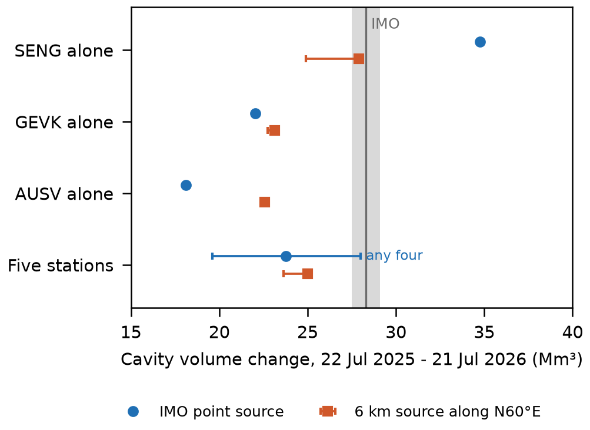

# Iceland Volcano Watch

[](https://doi.org/10.5281/zenodo.24288620)
[](LICENSE)
[](#data-and-licences)

How much magma has collected beneath Svartsengi, Iceland, and how sure can we be? This repository answers that from
free data only: GNSS stations (Nevada Geodetic Laboratory), Sentinel-1 radar (COMET LiCSAR) and the Icelandic Met
Office earthquake catalogue. Every number is produced by a script here and can be rerun.

> Retrospective measurements only. **No eruption forecasts.** For hazard information see the
> [Icelandic Met Office](https://en.vedur.is/).

## Key findings

- **The published volume depends on which stations you use.** With the Icelandic Met Office's own model (a point
  source at 4 km), the five open GNSS stations give 18 to 35 Mm³ for July 2025 to July 2026 one by one, and 20 to 28
  Mm³ in any group of four. The published value is 28.3 Mm³ (±3 %).
- **Radar shows why.** The volume a station would report varies around the source by 17 to 25 %, highest along
  N58-62°E, the direction of the crater row. Stations on that axis read high, stations beside it read low.
- **The source is extended along the crater row.** A source 4 to 6 km long along N60°E reproduces this pattern; a
  single pressurised prolate cavity does not. Placed slightly north of and shallower than the published source, it
  brings the stations within a factor of 1.1 to 1.25.
- **So absolute volumes carry a structural uncertainty of tens of per cent**, far more than the quoted ±3 %.
  Comparisons within one fixed method remain useful.



*Left: the volume a GNSS station would report at each place (radar, April to July 2025). Right: the same around the
source in three periods; dashed, the 6 km source.*



What is still open: a westward asymmetry of the uplift that no model explains, and station-scale motion at the
Grindavík stations. Full results, the other pilots (seismicity, geothermal subsidence at Hellisheiði, a damaged
Hengill catalogue copy) and all comparisons with published values are in [docs/results.md](docs/results.md).

## What is inside

| Question | Script | Output |
|---|---|---|
| Volume by station set, published model | `scripts/network_volume.py` | `docs/data/network_volume_*.csv` |
| Radar "virtual stations" and ring harmonics | `scripts/implied_volume.py`, `implied_volume_harmonics.py` | `docs/data/implied_volume_*.csv` |
| Joint GNSS + radar source fits | `scripts/elongated_source.py`, `cdm_source.py` (CDM port: `cdm.py`) | `docs/data/elongated_source*.csv`, `cdm_source*.csv` |
| Robustness checks | `insar_only_geometry.py`, `east_up_consistent.py`, `background_sensitivity.py`, `robustness_checks.py`, `two_source.py` | `docs/data/` |
| Figures | `scripts/paper_figures.py` | `docs/img/paper/` |

Method and limitations: [docs/method.md](docs/method.md). Prior work: [docs/prior-work.md](docs/prior-work.md).
Corrections to earlier versions: [docs/corrections.md](docs/corrections.md). Three independent reviews and the
responses: [docs/review-2026-11-16.md](docs/review-2026-11-16.md).

## Reproduce

```bash
uv venv --python 3.12 .venv && uv pip install --python .venv/bin/python -r requirements.txt
.venv/bin/python -I -m unittest discover -s tests -v      # 41 tests on synthetic cases, no data needed
```

The full pipeline downloads about 190 MB into the git-ignored `data/`; the steps are in
[docs/method.md](docs/method.md). Fixed inputs and their sources are in `config/svartsengi.json`.

## Data and licences

| Data | Terms | Credit |
|---|---|---|
| NGL GNSS time series | citation requested | Blewitt, Hammond & Kreemer (2018), *Eos* 99 |
| COMET LiCSAR interferograms | UK Open Government Licence 3.0 | Contains modified Copernicus Sentinel data 2015-2026 analysed by COMET; Lazecký & Maghsoudi (2022) |
| IMO Quakes API | CC BY 4.0 | Icelandic Meteorological Office |
| IMO volume figures | quoted from news items | cited, not redistributed |
| COSEISMIQ catalogues | CC0 | Grigoli et al. (2022) |

Only derived tables and figures are stored here; raw downloads stay in `data/`.

## How to cite

Ismoilov, O. (2026). iceland-volcano-watch: open-data analysis of the Svartsengi magma accumulation (GNSS,
Sentinel-1), version 1.0.0. Zenodo. https://doi.org/10.5281/zenodo.24288621

## How this was made

The analysis code was written largely with an AI coding assistant (Claude, Anthropic) under the author's direction.
Every number comes from a script in this repository, tested on synthetic cases with known answers and checked
against published values where they exist. Mistakes found along the way are logged in
[docs/corrections.md](docs/corrections.md).

## Licence

Code: MIT ([LICENSE](LICENSE)); the CDM port keeps its original MIT notice. Derived tables and figures: CC BY 4.0.

---

<p align="center">
  <sub>Powered by</sub><br>
  <a href="https://github.com/bristleconelab">
    <picture>
      <source media="(prefers-color-scheme: dark)" srcset="docs/img/brand/bristleconelab-horizontal-on-dark.svg">
      
    </picture>
  </a>
</p>
