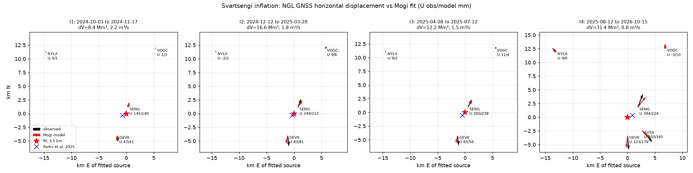
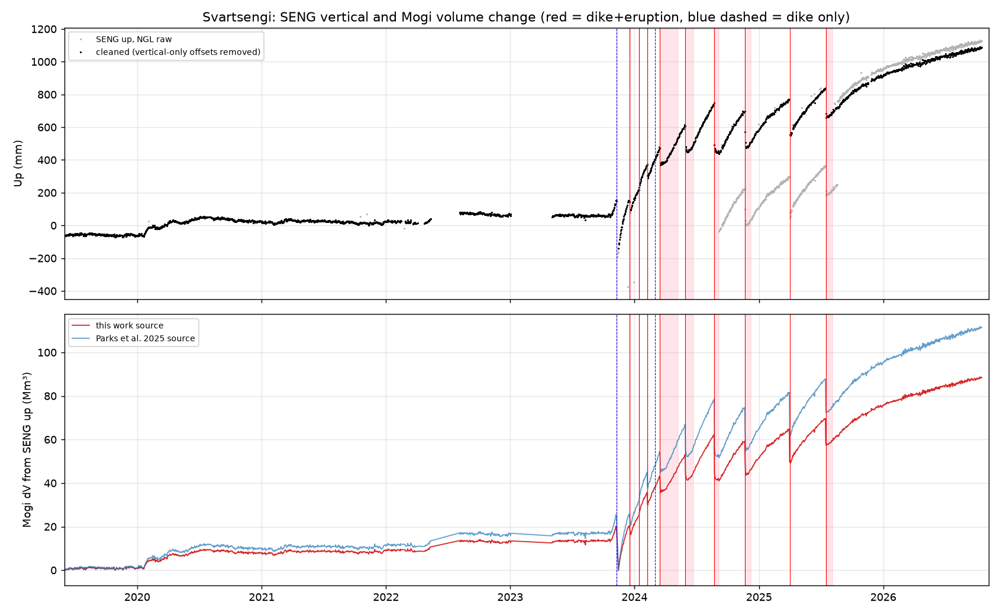
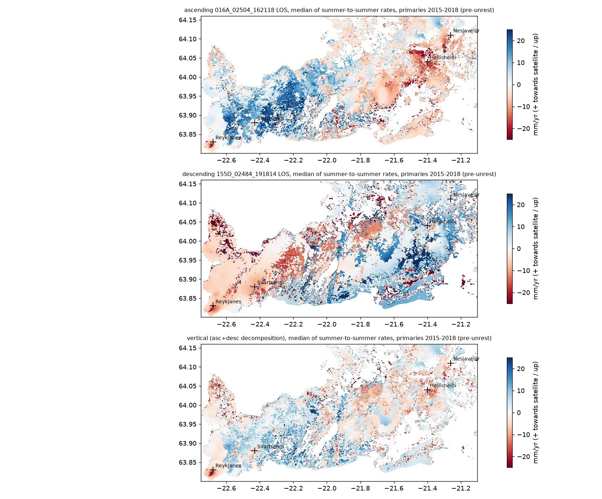
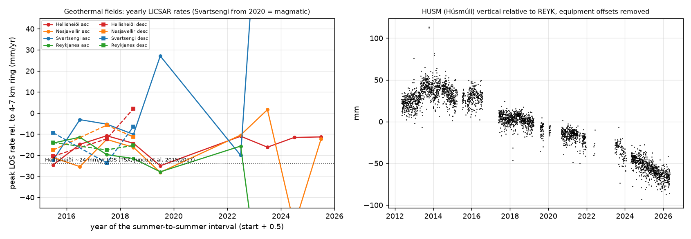

# Method

All inputs are free and need no account. Downloads go to `data/raw/<source>/` (git-ignored) and are only parsed as
data (CSV, GeoTIFF, text). Every number in the README comes from a CSV in `docs/data/` written by a script below.

| Script | Pilot | Input | Output |
|---|---|---|---|
| `scripts/fetch_imo_quakes.py` | B | IMO Quakes API (`api.vedur.is/quakes`, CC BY 4.0) | `data/raw/imo/*.csv` |
| `scripts/licsar_annual.py` | C | COMET LiCSAR unwrapped interferograms (window reads over HTTP) | `data/raw/licsar/<frame>/` |
| `scripts/ivwlib.py` | all | NGL `.tenv3` loader, offset cleaning, Mogi model, event list | |
| `scripts/svartsengi_gnss.py` | A | NGL IGS20 daily GNSS | Mogi fits, volume series, per-event and per-cycle volumes |
| `scripts/reykjanes_seismicity.py` | B | IMO SeisComP + SIL catalogues | dike migration, rates, Mc and b-values |
| `scripts/geothermal_deformation.py` | C | LiCSAR annual pairs, NGL HUSM/REYK | field subsidence rates, maps |
| `scripts/prior_work_map.py` | | LiCSAR DEM crop | prior-work map |
| `scripts/fetch_hengill_catalogs.py` | D | Zenodo 16311162, COSEISMIQ figshare | `data/raw/hengill/` |
| `scripts/hengill_catalog.py` | D | COSEISMIQ HQDD, IMO SIL + SeisComP (Hengill box), NGL HUSM/REYK | `docs/data/hengill_catalog.json`, two figures |
| `scripts/seislib.py` | B | copied unchanged from the sibling `seismo-lab` project | |

```bash
uv venv --python 3.12 .venv && uv pip install --python .venv/bin/python -r requirements.txt
mkdir -p data/raw/ngl && for s in SENG AUSV GEVK VOGC NYLA HUSM REYK; do
  curl -sS -o data/raw/ngl/$s.tenv3 https://geodesy.unr.edu/gps_timeseries/IGS20/tenv3/IGS20/$s.tenv3; done
.venv/bin/python -I scripts/fetch_imo_quakes.py --system seiscomp --mode all --start 2023-10-01 --end 2026-11-12 \
    --bbox -22.9 63.70 -21.0 64.20 --out data/raw/imo/seiscomp_reykjanes_hengill_2023_2026.csv
.venv/bin/python -I scripts/fetch_imo_quakes.py --system sil --start 2020-01-01 --end 2026-11-12 \
    --bbox -22.9 63.70 -21.0 64.20 --out data/raw/imo/sil_reykjanes_hengill_2020_2026.csv
for f in 016A_02504_162118 155D_02484_191814; do .venv/bin/python -I scripts/licsar_annual.py --frame $f \
    --bbox -22.75 63.80 -21.10 64.16 --years 2015-2025 --per-year 3 --out data/raw/licsar/$f; done
.venv/bin/python -I scripts/svartsengi_gnss.py
.venv/bin/python -I scripts/reykjanes_seismicity.py --catalog data/raw/imo/seiscomp_reykjanes_hengill_2023_2026.csv \
    --sil data/raw/imo/sil_reykjanes_hengill_2020_2026.csv
.venv/bin/python -I scripts/geothermal_deformation.py
.venv/bin/python -I scripts/prior_work_map.py
# Pilot D (Hengill catalogue)
.venv/bin/python -I scripts/fetch_hengill_catalogs.py
for s in sil seiscomp; do .venv/bin/python -I scripts/fetch_imo_quakes.py --system $s --start 1991-01-01 --end 2026-11-14 \
    --bbox -21.75 63.90 -20.85 64.20 --window-days 92 --out data/raw/imo/${s}_hengill_1991_2026.csv; done
.venv/bin/python -I scripts/hengill_catalog.py
```

## Pilot A: Svartsengi magma domain from GNSS

**Data.** Nevada Geodetic Laboratory (NGL) daily positions in IGS20, stations SENG (Svartsengi, 2015-), AUSV
(Grindavík, Nov 2023-), GEVK (Apr 2024-), VOGC (Sep 2024-) and NYLA (2006-), all to 17 Oct 2026. IMO's own
stations THOB, SKSH and ELDC are not in the NGL holdings.

**Cleaning.** NGL leaves SENG with two vertical-only jumps that are not in its `steps.txt`: −473 mm on 2024-09-05
and +513 mm on 2025-08-19. Neither has any horizontal motion (< 25 mm), any nearby station moving, or a dike at
that time, and they nearly cancel, which points to wrong antenna-height metadata between those dates. They are
detected automatically (5-day medians either side) and removed. The detector ignores ±3 days around dike onsets,
because dikes move SENG by decimetres to metres. Gross outliers are > 5 robust σ from an 11-day running median.

**Background.** SENG's 2015.5-2019.9 trend, before any unrest, is −16.4 mm/yr up (NYLA −5.5 mm/yr). That covers
geothermal-field subsidence, regional subsidence and GIA together. It is removed from SENG's vertical as a
constant term. Horizontal plate motion is absorbed by a common E/N translation in each fit.

**Mogi fits.** For four inflation-only intervals (no dike between the end dates), 5-day mean displacements are fitted
with a Mogi point source in an elastic half-space (ν = 0.25). The source position (0.004° × 0.002° grid) and depth
(1.5-8 km, 0.25 km step) are found by grid search; ΔV and the translation are solved by linear least squares.
Errors are 3 mm horizontal and 8 mm vertical, plus 5 % of the signal as model error. The depth range is where
χ² ≤ χ²_min + scale (scale = χ²_min/dof when > 1). The jackknife drops one station at a time.



**Volume series.** With the source fixed (median of the four fits: −22.446 E, 63.872 N, 3.75 km), the SENG
vertical becomes a volume series: ΔV = u_z / G_z, with G_z = 14.4 mm per Mm³. With Parks et al.'s source
(−22.454 E, 63.869 N, 4 km), G_z = 11.4 mm per Mm³, so volumes are 26 % larger. Per event, the volume lost runs
from the day before onset to the minimum within 7 days. Per cycle, the recharge runs from that minimum to the day
before the next event.



**Limitations (A).**
- One station (SENG) drives the volume series. Where a dike passes close to SENG, the dike's own deformation
  contaminates its vertical. Events 1 (10 Nov 2023), 2, 3, 5 and 10 (1 Apr 2025, ~20 km dike) are badly
  underestimated or have the wrong sign. The series is valid for inflation, and for losses at events whose
  dike stayed away from SENG (4, 6, 7, 8, 9, 11).
- Volumes depend on the source geometry: ±26 % between our source and Parks et al.'s. SENG sits 1.8 km from the
  source, so G_z is very sensitive to depth.
- I4 (Aug 2025 to Oct 2026, 429 days) fits badly (RMS 49 mm). One point source cannot match SENG's +394 mm uplift
  together with the Grindavík stations. Possible causes: a change in source shape, post-dike motion inside the
  Grindavík graben, or a SENG-specific signal. Not resolved.
- Depth is poorly constrained by 4-5 stations (jackknife 2.5-5.0 km). The InSAR in Pilot C was not used for
  Mogi fits.
- Formal velocity errors assume white noise and are too small (coloured noise not modelled).

## Pilot B: seismicity

**Catalogues.** The IMO Quakes API serves two systems. **SeisComP** (primary since Feb 2026, magnitude type `ML_SIL`; we fetched
it from Oct 2023 for Reykjanes, but reviewed events exist further back: from 2015-06-20 in the Hengill box) is the only continuous catalogue through the current cycle. **SIL**
(legacy) has reviewed events until early Feb 2026 and is much denser during the Nov 2023 dike. We use SeisComP
for everything from Oct 2023 on (rates, b-values per cycle), and SIL for the 10 Nov 2023 dike and for 2020-2023.
Only reviewed (`manual`) events of type earthquake (or no type) are used.

**Dike geometry.** Epicentres from 10 Nov 12:00 to 12 Nov 00:00 UTC. The strike is the principal axis of the
epicentres. Length is the 2.5-97.5 % range along strike. The front is the 5 % and 95 % along-strike quantiles
in hourly bins with ≥ 20 events.

**Rates vs inflation.** One Mc is used for all inter-event periods: the larger of the inter-event (Dec 2023 to
Jul 2025) and current-cycle Mc. Daily counts M ≥ Mc are compared with the Pilot A volume series, and with Spearman
rank correlations over the inter-event periods.

**Mc and b.** Mc is the larger of MAXC+0.2 and goodness-of-fit (90/95 %). b-value stability (MBS) is also
computed and used only when at least 200 events lie above it (for the dike swarm MBS gave 3.8 on 66 events, so it
was not used). b uses
Aki-Utsu with Shi-Bolt error and 500 bootstraps, plus b-positive (van der Elst 2021, ΔM ≥ 0.2), which is robust to
short-term incompleteness.

**Limitations (B).** Magnitudes are local (`ML_SIL`), not Mw. The network changed during the sequence (stations
added around Grindavík), so Mc varies in time. A single Mc per period is a simplification. Aki-Utsu b and
b-positive disagree in some sets (see README), which is itself a sign of time-varying completeness.

## Pilot C: geothermal fields

**InSAR.** LiCSAR frames 016A_02504_162118 (ascending) and 155D_02484_191814 (descending) both cover the whole
peninsula window. We use only summer-to-summer pairs: both dates in June-September, 330-400 days apart, up to 3
per year with distinct primaries. Winter pairs decorrelate under snow. Pixels with coherence < 0.25 are masked.
Each pair is scaled to mm/yr and the yearly median is taken. Field rates are the 5th percentile (3×3 smoothed)
within 1.5 km of the field centre, minus the median of a 4-7 km ring. The ring removes the plate-spreading
gradient, which is clearly visible: ascending and descending maps have opposite-sign east-west gradients.
Ascending and descending pre-unrest median maps are combined into vertical and east (north ignored).

**LiCSAR availability.** 6 ascending pairs (2020-2022 primaries) and 9 descending pairs (2019-2021 primaries) are
listed in the LiCSAR index but return HTTP 403/404. The descending vertical decomposition is therefore only
possible for primaries 2015, 2017 and 2018 (pre-unrest).

**GNSS.** HUSM (Húsmúli re-injection area) relative to REYK, with an annual term and an offset at the 2017-02-09
equipment change from NGL's steps file (the 2016-07-26 change has no data after it and before the next one).




**Limitations (C).**
- LiCSAR has ~100 m pixels and contains unwrapping errors (visible as patches in the descending map). The yearly
  median of three pairs helps but does not remove them all. Peaks are smoothed compared with 3 m TerraSAR-X.
- The ring reference assumes no deformation 4-7 km from the field centre. That is not true at Svartsengi after
  2020 (magmatic) or at Hengill if the bowl is wider than 4 km.
- Field centres are approximate plant/well-field locations, not production-weighted.
- Svartsengi geothermal vs magmatic: see README §C.

## Pilot D: the Zenodo Hengill catalogue (added 2026-11-14)

**What the file is.** Zenodo record 10.5281/zenodo.16311162 ("Hengill seismic catalog", University of Campania,
2025-07-22, CC BY 4.0) holds one file, `hen_conv.dat`: 8,691 rows, five numeric columns, no header. The record
text says "1 col) time (sec) 2 col) latitude 3 col) longitude 4 col) event magnitude 5 col) depth" and nothing
about method or magnitude type. Every row matches an event of the COSEISMIQ high-quality double-difference
catalogue, `catalogue_HQDD.csv` (Grigoli et al. 2022, *Scientific Data* 9:220; figshare, CC0), which also has
8,691 rows:
- latitude and longitude agree within 5×10⁻⁶ degrees for 8,685 rows (the Zenodo values are single precision);
- column 4 is the HQDD **depth** (8,653 rows within 1 m) and column 5 is the HQDD **magnitude**, so the record text
  swaps the two;
- column 5 equals the HQDD magnitude's **absolute value** for 8,686 rows. HQDD has 2,054 negative magnitudes; the
  Zenodo file has none. The minus sign was lost;
- column 1 is not seconds. It is (days since 2018-01-01 + 1) / 365, printed with 7 significant digits. That gives a
  resolution of 3 s before 2019 and 32 s after, and 1,517 rows (Dec 2018, Dec 2019-Feb 2020, Dec 2020) sit one day
  off the HQDD origin time.

Magnitudes are local magnitudes, ML, from Wood-Anderson-simulated amplitudes (Grigoli et al. 2022). They are not
calibrated to IMO's scale. Because the Zenodo file lost the signs, rounded the times and has a one-day error in
five months, **all statistics below use the HQDD file**, which holds the same events.

**Comparison with IMO.** Window 2018-12-01 to 2021-01-31 (793 days), Pilot B Hengill box (21.50-21.15 W,
63.98-64.15 N). Reviewed IMO events from both systems: SeisComP (`ML_SIL`) and SIL. Events are matched within 3 s
and 3 km, one IMO event per COSEISMIQ event. Mc is the larger of MAXC+0.2 and GFT. b is Aki-Utsu with a 1,000-sample
bootstrap 95 % interval, plus b-positive.

**Húsmúli.** A 3 km circle around 64.055 N, 21.395 W, the centre of the induced cluster. The long series uses
SIL at M ≥ 1.0, which is above every yearly SIL MAXC in 2006-2025 (0.1-0.6). Periods are chosen to match the
HUSM GNSS rates of Pilot C. Re-injection start (Sep 2011) is from Juncu et al. 2018 (prior-work §3); we have no
injection-rate data.

**Limitations (D).**
- COSEISMIQ covers only Dec 2018 to Jan 2021. It overlaps the 2017-19 and 2020-26 HUSM periods but not the 2011
  start of injection or the 2012-15 uplift.
- Injection and production volumes are not open, so seismicity is compared with GNSS only, not with the cause.
- OLS slopes between magnitude scales are biased low by scatter in the x magnitude; we report medians of the
  differences and do not convert b between scales.
- Magnitudes stay in their own scales; Mc and b are not converted.
