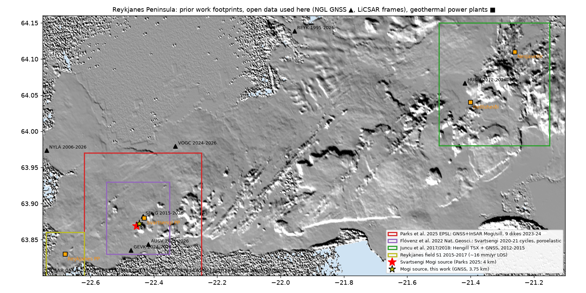

# Prior work and the open gap

Checked 2026-11-12. What is already published or operated for Reykjanes volcanism and geothermal deformation, and
where an open, reproducible monitor adds something.

*Footprints are approximate. ▲ = NGL GNSS stations used here, ■ = geothermal power plants, stars = Mogi sources.
`scripts/prior_work_map.py`.*

## 1. Svartsengi magma domain and the Sundhnúkur dikes

| Work | What it gives | Numbers we compare against |
|---|---|---|
| Parks et al. 2025, *EPSL* 658:119324 ([open PDF](https://eprints.whiterose.ac.uk/id/eprint/229677/)) | 37 cGNSS + six SAR missions, joint Mogi / Okada-sill inversions, Nov 2023 to Dec 2024. Table 1 lists every dike: volume lost from the magma domain, dike volume, inflow rate | Mogi source −22.454 E, 63.869 N, 4 km (sill top 4.7 km); inflow ~7-9 m³/s at first, falling to ~2.4-4 m³/s in May 2024 to Jan 2025; per-event losses 2-77.8 Mm³ |
| Sigmundsson et al. 2024, *Science* | 10 Nov 2023 dike: ~15 km long, peak inflow above 7000 m³/s | dike length, timing |
| Parks et al., EGU26-6017 ([abstract](https://meetingorganizer.copernicus.org/EGU26/EGU26-6017.html)) | 2025 events | 1 Apr 2025: ~20 km dike, ~100 Mm³ dike, ~35 Mm³ domain loss; 16 Jul 2025: ~12 Mm³ domain loss; **recharge before the last five events 17-23 Mm³** |
| EGU25-17523, EGU26-12710 | Source depth and volume stability | 3-6 km, inflow 3-8 m³/s; source more stable since Mar 2024 |
| Flóvenz et al. 2022, *Nature Geoscience* ([InSAR data, Zenodo 6344933](https://zenodo.org/records/6344933)) | 2020-2021 Svartsengi uplift cycles, poroelastic model, magmatic CO₂ | 2020-21 unrest context |
| Icelandic Met Office (IMO) news ([latest, 9-10 Nov 2026](https://en.vedur.is/about-imo/news/ground-uplift-and-magma-accumulation-continue-beneath-svartsengi)) | Operational model volumes, alert level | 28.3 Mm³ (21 Jul 2026) and 29.1 Mm³ (18 Aug 2026; 95 % range 28.3-29.9) accumulated since 16/17 Jul 2025; ~4-5 cm uplift per 3 months in Sep 2026; alert level 2 |
| COMET LiCSAR / volcano portal | Automatic Sentinel-1 interferograms, frames 016A_02504_162118 (asc) and 155D_02484_191814 (desc) listed on LiCSAR's volcano frame status page | open input data, no volume series |

## 2. Seismicity

| Work | What it gives |
|---|---|
| IMO catalogue, now open through the **Quakes API** (`https://api.vedur.is/quakes/`, OpenAPI spec version 2026-08-06, **CC BY 4.0**). Two systems: `sil` (legacy, reviewed back to 1991) and `seiscomp` (primary since Feb 2026, reviewed events back to 2015-06-20 in the Hengill box, magnitude type `ML_SIL`) | the catalogue used here |
| Figlioli et al. 2026, *Bollettino di Geofisica Teorica e Applicata* ([PDF](https://bgo.ogs.it/sites/default/files/pdf/bgo00528_Figlioli.pdf)) | b-value, rate and energy for the 2020-2024 Reykjanes sequence from the IMO catalogue; b-value drops are not uniquely tied to eruptions |
| Winder et al., EGU26-8103 | relative relocations of the repeated Sundhnúkur dikes |
| ICEL-NMAR (Mendeley 7zh6xg22cv) | Mw ≥ 4 catalogue 1900-2019 (not used yet) |
| Hengill seismic catalog, Zenodo 10.5281/zenodo.16311162 (University of Campania, 2025, CC BY 4.0) | 8,691 events, no method or magnitude type stated. It is a lossy copy of COSEISMIQ HQDD (signs of 2,054 negative magnitudes lost, depth/magnitude columns swapped in the description, times rounded to 3-32 s and 1,517 rows one day off); see method, Pilot D |
| COSEISMIQ catalogues, Grigoli et al. 2022, *Scientific Data* 9:220, doi:10.1038/s41597-022-01339-w (figshare 10.6084/m9.figshare.c.5725592, CC0) | Hengill, Dec 2018-Jan 2021, dense temporary network; ML; HQ and HQDD ~8,500 events; Mc 0.5-1.0 stated |

## 3. Geothermal-field deformation

| Work | Numbers |
|---|---|
| Juncu et al. 2017, *JGR* 122:692-709, doi:10.1002/2016JB013626 ([open PDF](https://eprints.whiterose.ac.uk/113137/)); EGU2015-13455 | Hengill 2012-2015: "up to 26 mm/yr LOS" (p. 704) and "~24 mm/yr" (EGU2015, data from Oct 2009) at Hellisheiði: the most negative pixel of a TerraSAR-X track 41 ascending velocity field after a plate-motion model is removed, referenced to a point near GFEL (Fig. 7, p. 700); production ~40 Mt/yr 2012-14, ~32 Mt/yr in 2015 (p. 696); GNSS campaign maxima 23 mm/yr (HH47, Hellisheiði) and 18 mm/yr (NE63, Nesjavellir) subsidence; OLKE/HVER ~10 mm/yr wide-area subsidence; reservoirs 0.6-3 km |
| Juncu et al. 2020, *JVGR* 391:106337, doi:10.1016/j.jvolgeores.2018.03.019 (online 2018) | "up to 2 cm of surface displacements during 2011-2012" at the start of Húsmúli re-injection (Sep 2011, ~500 kg/s); semi-continuous GPS shows most of it in the first months |
| Ducrocq et al. 2021, *Front. Earth Sci.* 9:725109, doi:10.3389/feart.2021.725109 | Sentinel-1 tracks 16, 118, 155 and TerraSAR-X T41 mean LOS velocities for 2015-2017 and 2017-2018, referenced near GFEL (Fig. 5, p. 7); Ölkelduháls uplift Nov 2017-Mar 2018 (~12 mm, ~11 km wide); Húsmúli subsidence 2017-18 (up to −8 mm, 6 km wide; p. 10); Hellisheiði expanded in 2016 with Hverahlíð wells (p. 3). Read with our statistic in `published_figures_digitized.json` |
| Reykjanes field, Sentinel-1 2015-2017 (ÍSOR report for Landsnet, 2021) | ~16 mm/yr LOS subsidence bowl on the well field |
| Svartsengi, 1975-2015 levelling/model (UNU-GTP thesis) and EGU2009-5142 | 7-14 mm/yr regional subsidence; ~1 cm/yr around the plant, tied to production |
| EGMS (Copernicus) | Iceland in the 2019-2023 release; download goes through the EGMS Explorer with a free account. Not tried here: LiCSAR was enough for a first look |

## 4. The gap

1. **No open, reproducible volume series.** IMO publishes model volumes as numbers in news items; Parks et al. give
   a table to Dec 2024. Nobody publishes code that turns open GNSS into a Svartsengi volume series that anyone can
   rerun and check against those numbers. This project does that with NGL time series (free, no login).
2. **The 2025-2026 cycle is outside every paper.** The longest inter-event period so far (Aug 2025 to now) is only
   described in news items.
3. **Geothermal vs magmatic at Svartsengi.** We found no study that separates the Svartsengi power-plant subsidence
   from the magmatic signal after 2020 (Flóvenz et al. 2022 discuss fluids, not production). The pre-unrest
   background can be measured with open data and carried forward as a known term.
4. **Open catalogue statistics** with the new CC BY Quakes API: rates and b-values per inflation cycle are not
   published in a reproducible form.
